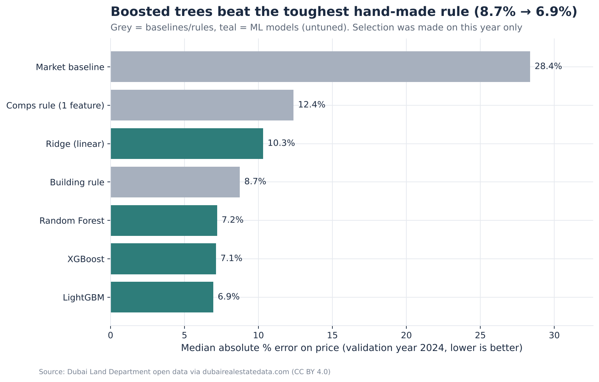
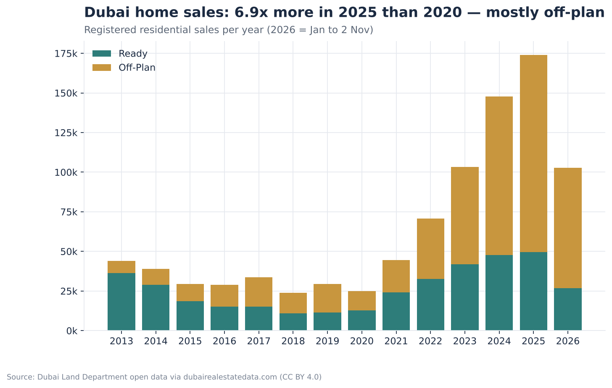
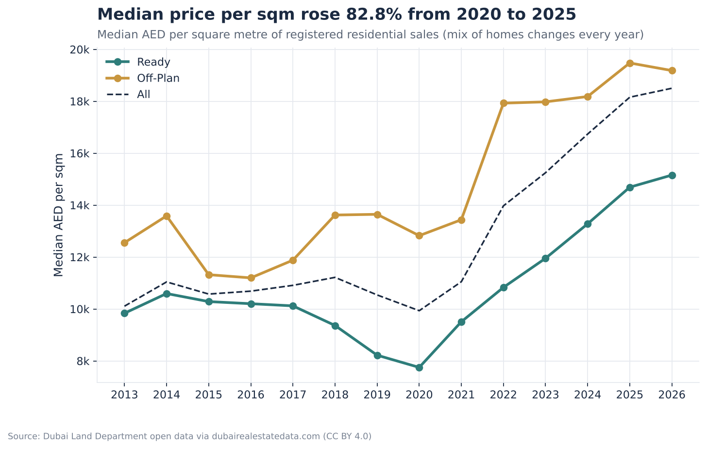
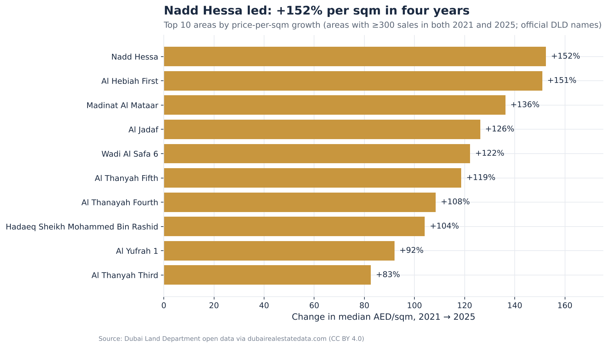
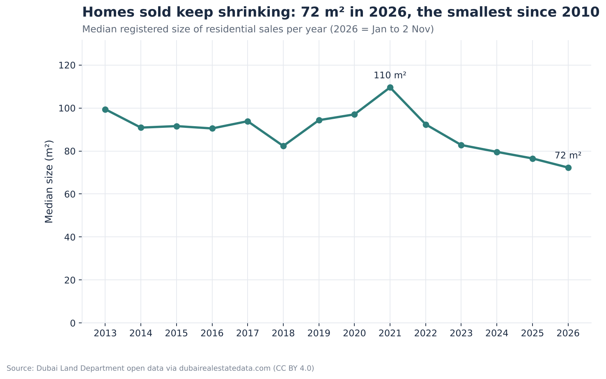
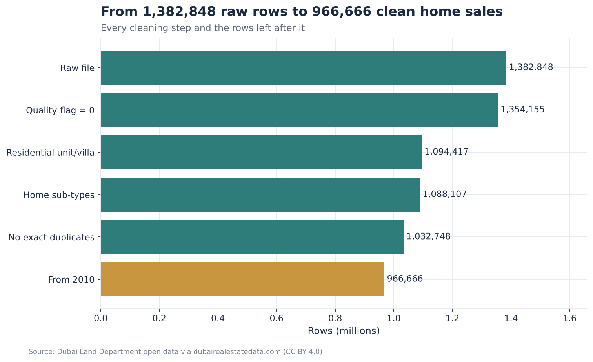
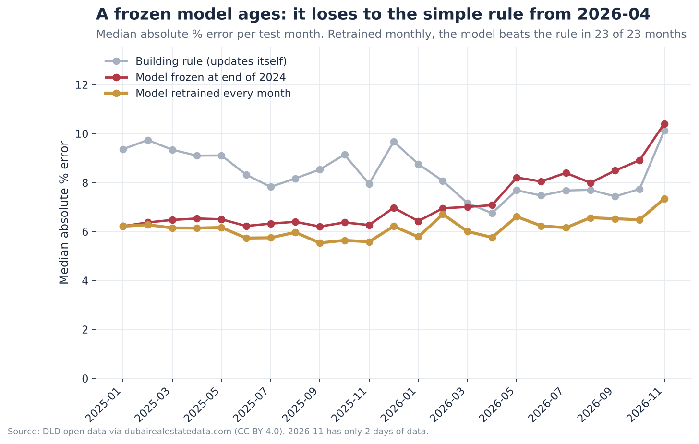
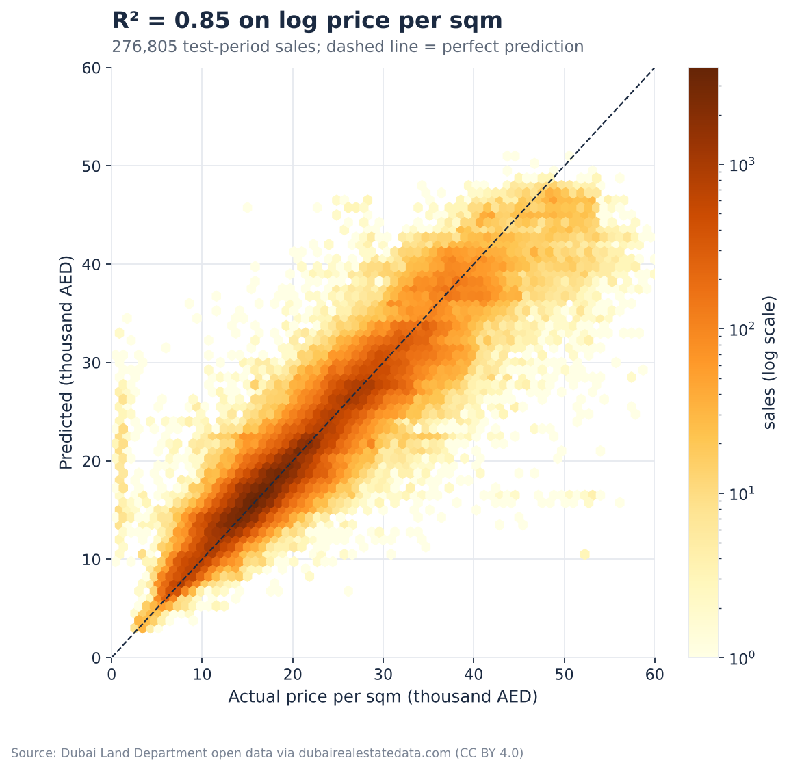
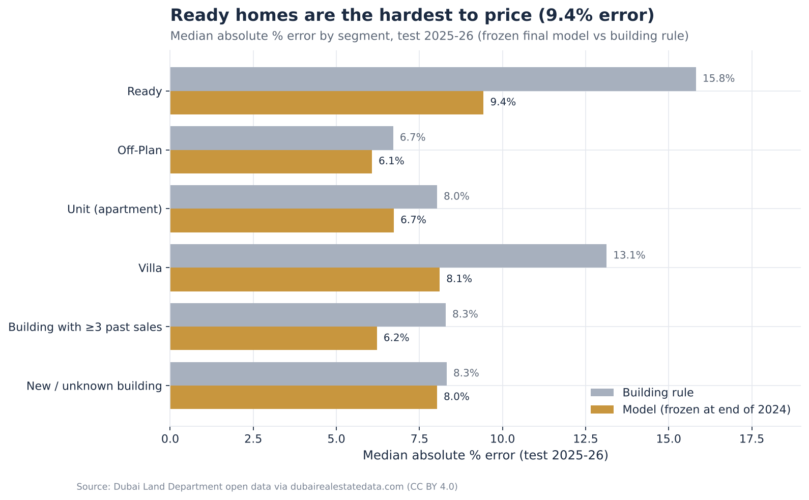
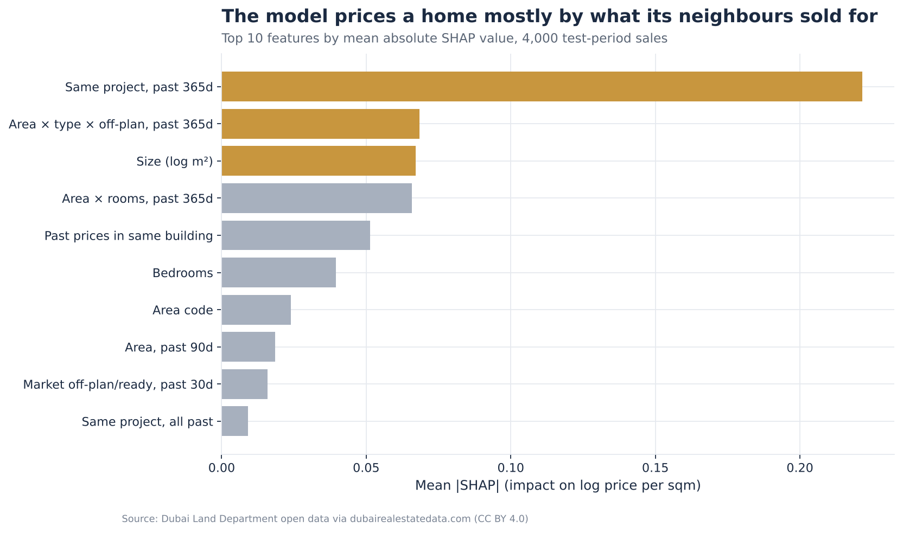

# What is a Dubai home worth? An honest price model on 1,382,848 official sales

Predicting the registered price of Dubai homes from what is known **on the day of the sale**, using residential
sales registered with the Dubai Land Department (DLD). Built to be honest first: no leakage,
a time-based split, tough baselines, and every number in this README generated from
[`results/metrics.json`](results/metrics.json).

**Headline (test period 2025-01-01 → 2026-11-02, never touched during development):**
the tuned LightGBM model gets a **median error of 6.80%** on the sale price, with
**65.3%** of 276,805 sales predicted within ±10%. The toughest hand-made rule
(past prices in the same building) gets 8.30% — so the model cuts the
error by **18.1%**.
**But:** a model frozen at the end of 2024 ages. It beats that rule in only
15 of 23 test months and loses from
2026-04 on. Retrained every month, it beats the rule in
23 of 23 months (median error 6.03%).



## The data
* **Source:** [Dubai Real Estate Data](https://www.kaggle.com/datasets/tomasgrygar/dubai-real-estate-sales-transactions) — DLD open data (Dubai Pulse), snapshot to 2026-11-02.
* **License:** CC BY 4.0 — "Dubai Real Estate Data (dubairealestatedata.com), based on Dubai Land Department open data."
  The data is not stored in this repo; download it from Kaggle into `data/`.
* Every row is a **registered sale**, not an asking price.

## What the data says
1. Sales exploded: **173,914** home sales in 2025 (after cleaning) vs **25,028** in 2020 (6.9x).
2. Off-plan took over: **71.5%** of 2025 home sales were off-plan, up from 46.0% in 2021.
3. Median price per m² went from AED 9,934 (2020) to AED 18,156 (2025): **+82.8%**.
4. Homes are shrinking: the median home sold in 2026 is **72.3 m²**, the smallest since 2010 (2021: 109.6 m²).
5. Cheaper areas caught up: **Nadd Hessa** rose **+152.5%** per m² (2021→2025) while Marsa Dubai (Dubai Marina) rose 38.7% (among 30 areas with ≥300 sales in both years).
6. In 2025 off-plan sold at AED 19,476/m² vs AED 14,691 for ready homes (+32.6%) — this compares different homes in different areas, so it is not a like-for-like premium.
7. One area — Al Barsha South Fourth (marketed as Jumeirah Village Circle) — had **17,285** sales in 2025, 9.9% of the whole market.

| | |
|---|---|
|  |  |
|  |  |

## Problem set-up
* **Target:** log(price per m²) of a registered sale. Price = prediction × size, so % error on price = % error on price per m².
* **Rows:** residential units and villas, 966,666 sales after cleaning (2010-01-01 → 2026-11-02).
* **Split (by date, no shuffling):** train 2013-01-02 → 2023-12-29 (472,273),
  validation 2024-01-01 → 2024-12-31 (147,747),
  test 2025-01-01 → 2026-11-02 (276,805).
* **Main metric:** median absolute % error (MdAPE) on price, plus the share within ±10% / ±20% (how automated valuation models are judged).

### Cleaning (every step logged)
| Step | Why | Rows removed | Rows left |
|---|---|---:|---:|
| quality_flags == 0 | publisher's own checks: price floor, area range, P1-P99 psf band, bad dates | 28,693 | 1,354,155 |
| residential Unit/Villa only | Land trades on plot area and whole Buildings price wholesale; commercial units price differently | 259,738 | 1,094,417 |
| drop non-home sub-types | offices/shops/hotel rooms/hotel apartments registered under Residential | 6,310 | 1,088,107 |
| drop exact duplicates (all columns except transaction_id) | cannot tell identical bulk sales from re-registrations; keep one so no single deal dominates | 55,359 | 1,032,748 |
| date >= 2010-01-01 | pre-2010 years are thin (<10k rows/yr before 2007) and only add noise to rolling history | 66,082 | 966,666 |



### How leakage is prevented
* All 23 features are things known when the sale is registered. History features
  (past prices in the same building / project / area / segment / market) are computed from a **daily aggregate with a
  left-closed time window**: a sale on day *D* only sees sales registered on days **before** *D* — not even the same day.
* [`tests/test_no_leakage.py`](tests/test_no_leakage.py) proves it two ways: (1) recomputes features for random rows by brute force
  from earlier days only and checks they match; (2) scrambles every price from a cutoff day onward and checks that no feature of any
  sale on or before that day changes.
* Model choice, early stopping and Optuna tuning used the 2024 validation year only. The test period was scored once at the end.

## Results
### Validation year (2024) — used for all choices
| Model | MdAPE | within ±10% | within ±20% | R² (log price/m²) | |
|---|---:|---:|---:|---:|---|
| Market baseline | 28.37% | 16.9% | 34.1% | 0.126 |  |
| Comps rule (1 feature) | 12.37% | 42.0% | 70.0% | 0.716 |  |
| Building rule | 8.74% | 54.7% | 79.5% | 0.807 |  |
| Ridge (linear) | 10.32% | 48.7% | 78.7% | 0.839 |  |
| Random Forest | 7.21% | 63.4% | 88.3% | 0.894 |  |
| XGBoost | 7.13% | 63.8% | 89.4% | 0.900 |  |
| LightGBM | 6.95% | 65.0% | 89.8% | 0.904 |  |
| LightGBM (tuned) | 6.88% | 65.3% | 89.6% | 0.903 |  |

Optuna (25 trials, LightGBM) moved validation MdAPE from 6.947% to 6.883% — a small gain.

### Test period (2025-01-01 → 2026-11-02)
| Model | MdAPE | within ±10% | within ±20% | R² (log price/m²) | |
|---|---:|---:|---:|---:|---|
| Market baseline | 25.47% | 21.6% | 40.2% | 0.121 | reference only |
| Comps rule (1 feature) | 12.46% | 41.3% | 71.3% | 0.670 | reference only |
| Building rule | 8.30% | 56.8% | 81.4% | 0.768 | reference only |
| Ridge (linear) | 12.40% | 42.0% | 69.9% | -0.850 | reference only |
| Random Forest | 7.63% | 60.5% | 84.8% | 0.818 | reference only |
| XGBoost | 8.44% | 56.7% | 82.1% | 0.622 | reference only |
| LightGBM | 7.50% | 61.5% | 86.8% | 0.836 | reference only |
| LightGBM (tuned, final) | 6.80% | 65.3% | 88.2% | 0.847 | **selected on validation** |
| LightGBM retrained monthly (walk-forward) | 6.03% | 70.1% | 91.0% | 0.868 | same settings, refit before each month |

Ridge's negative R² is real, not a typo: its errors grow sharply in 2026 (a linear model extrapolates badly once the market moves
outside the training range), so its squared error exceeds the spread of the prices themselves. The main metrics stay the median
error and the ±10% / ±20% shares.

| | |
|---|---|
|  |  |

### Where it works and where it doesn't (test, frozen model)
| Segment | Sales | Model MdAPE | Building rule MdAPE |
|---|---:|---:|---:|
| Off-plan | 200,500 | 6.07% | 6.71% |
| Ready | 76,305 | 9.43% | 15.82% |
| Unit (apartment) | 259,256 | 6.73% | 8.03% |
| Villa | 17,549 | 8.11% | 13.13% |
| Building with ≥3 past sales | 173,832 | 6.22% | 8.29% |
| New / unknown building | 102,973 | 8.03% | 8.32% |



### How sure is it?
This is regression, so instead of probability calibration the uncertainty is checked directly: an 80% interval built on
2024 residuals (split conformal, ±0.1449 in log space ≈ -13.5% / +15.6%)
covered **79.2%** of test sales (worst month 68.5%).

### Why it predicts what it predicts (SHAP)


### Case studies (real test sales)
| Case | Date | Area | Home | Actual AED | Predicted AED | Error | Past sales in building | Top SHAP features |
|---|---|---|---|---:|---:|---:|---:|---|
| hit | 2025-07-21 | Wadi Al Safa 5 | Off-Plan Unit, 70.0 m² | 1,049,155 | 1,057,000 | +0.8% | 6 | Same project, past 365d, Area × type × off-plan, past 365d, Size (log m²) |
| over_estimate_p99 | 2026-02-26 | Al Hebiah First | Ready Unit, 201.5 m² | 1,735,000 | 2,848,000 | +64.2% | 0 | Same project, past 365d (no data), Area × rooms, past 365d, Size (log m²) |
| under_estimate_p99 | 2025-12-17 | Palm Deira | Off-Plan Unit, 136.0 m² | 5,065,000 | 3,428,000 | -32.3% | 0 | Area × type × off-plan, past 365d, Area × rooms, past 365d, Past prices in same building (no data) |

The two misses are 99th-percentile errors, not the single worst rows. Both are homes with **no past sales in their building**, so the model falls back on area-level averages — and these two homes do not look like their area's average.

## Limitations
* It predicts the **registered** price. It knows nothing about view, floor, finishing, or a motivated seller.
* It leans on recent sales nearby. New / unknown buildings are clearly harder.
* **It ages.** Frozen at the end of 2024, its error rose from 6.35% (first 3 test months) to
  9.27% (last 3). It needs regular retraining; the walk-forward result above is the realistic number.
  The last test month (2026-11) has only 2 days of data.
* EDA medians mix different homes each year, so a rising median is not a like-for-like price index.
* Exact duplicate rows were dropped because identical bulk sales cannot be told apart from re-registrations.
* Ridge was run with light settings; Random Forest on a 300,000-row subsample for speed.
* PerpetualBooster was tried too, but its scores changed between two identical runs, so it was dropped to keep the project reproducible. It was never the best model.

## Project structure
```
src/features.py       cleaning + leakage-safe features
src/modeling.py       split, baselines, models, metrics, Optuna, conformal interval
src/style.py          one chart theme
src/make_dashboard.py offline Plotly dashboard (dashboard/dubai_price_dashboard.html)
src/make_readme.py    renders this README from results/metrics.json
notebooks/            main notebook (+ a self-contained Kaggle version)
app/streamlit_app.py  results explorer + what-if simulator
tests/                leakage tests
scripts/verify_numbers.py  checks that every number in a text file exists in metrics.json
results/              metrics.json, test predictions, what-if lookup
models/               LightGBM frozen at 2024 (evaluated) + production model (refit on all data, used by the app)
```

## How to run
```bash
pip install -r requirements.txt
# download dld_sales_transactions.parquet from the Kaggle dataset into data/
pytest -q tests/                      # leakage tests
jupyter nbconvert --to notebook --execute --inplace notebooks/dubai_price_model.ipynb
python src/make_readme.py             # rebuild this README from metrics.json
python scripts/verify_numbers.py README.md
streamlit run app/streamlit_app.py
```
Open `dashboard/dubai_price_dashboard.html` in any browser (works offline).

## License
Code: MIT (see `LICENSE`). Data: CC BY 4.0, Dubai Real Estate Data (dubairealestatedata.com) based on Dubai Land Department open data.

---
Built by **Hussain Ahmed** · [GitHub](https://github.com/HussainAhmed75) · [Kaggle](https://www.kaggle.com/hussianahmed)
